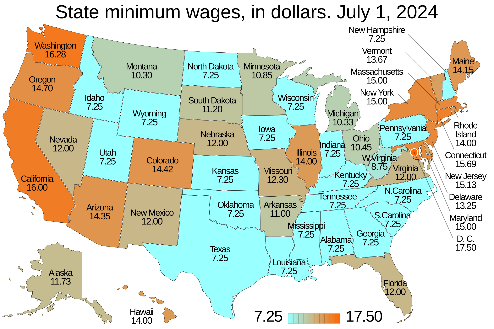

# Experiments and Quasi-Experiments {#sec-chapter20}

```{python}
import numpy as np
import pandas as pd
import matplotlib.pyplot as plt
import seaborn as sns
import statsmodels.api as sm
import statsmodels.formula.api as smf
from stargazer.stargazer import Stargazer
from linearmodels.panel import PanelOLS
from rdrobust import rdrobust,rdbwselect,rdplot
from warnings import simplefilter
simplefilter(action="ignore")
sns.set(style='darkgrid')
```

## Randomized controlled experiments
A **randomized controlled experiment** is a study designed to measure the effect of a treatment or policy intervention on an outcome variable by randomly assigning experimental units to treatment and control groups. The units in the treatment group receive the treatment or are subject to the intervention and those in the control group are not subject to any changes. We then measure the treatment or intervention effect by comparing the groups in terms of the outcome variable. We usually collect data on two variables of interest: the outcome variable, denoted by $Y$, and the treatment indicator, denoted by $D$, which specifies whether a unit is in the treatment or control group.

::: {#exm-chapter23.1}
## Clinical drug trial
Consider a randomized controlled experiment designed to assess whether a proposed drug lowers cholesterol levels. In this experiment, we have:

* $Y$ is the cholesterol level,
* $D=1$ if the individual is in the treatment group (i.e., receives the drug), and $D=0$ if the individual is in the control group (i.e., does not receive the drug).
:::

::: {#exm-chapter23.2}
## Job training program
Consider a randomized controlled experiment designed to assess the effect of a job training program on wages. In this experiment, we have:

* $Y$ represents the wage income,
* $D=1$ if the individual is in the treatment group (i.e., participates in the job training program) and $D=0$ if the individual is in the control group (i.e., does not participate in the job training program).
:::

::: {#exm-chapter23.3}
## Tennessee class size experiment
The Tennessee class size reduction experiment, known as Project STAR (Student–Teacher Achievement Ratio), was a 4-year experiment designed to evaluate the effect of class size on learning. Students were randomly assigned to one of three groups:

1. a regular class (22–25 students),
2. a regular class with a teacher's aide, or
3. a small class (13–17 students).

In this experiment, students then took standardized tests (the Stanford Achievement Tests) in reading and math. The goal of the experiment was to assess the effect of class type (regular, regular with an aide, or small) on test scores. In this experiment, we have one outcome variable and two treatment indicators:

* $Y$ is the test scores,
* $D_1=1$ if the student is in a small class (i.e., the student is in the treatment group), and $D_1=0$ if the student is in a regular class (i.e., the student is in the control group).
* $D_2=1$ if the student is in a regular class with a teacher's aide (i.e., the student is in the treatment group) and $D_2=0$ if the student is in a regular class (i.e., the student is in the control group).
:::

In all these examples, the experiment is deliberately designed and implemented to assess the causal effect of a treatment or intervention on the outcome variable. The assignment mechanism is the key feature that distinguishes randomized controlled experiments from other types of studies. A randomized controlled experiment is one in which the assignment mechanism satisfies the following properties (@Imbens2015, @Titiunik2021):

1. It is designed and implemented by the researchers.
2. It is known to the researchers.
3. It ensures randomization such that the probability of participating in the treatment does not depend on the potential outcomes (defined below) of the experimental units.

## Potential outcomes and causal effects

To define the treatment effect, we need to first introduce the potential outcomes framework.

:::{#def-chapter23.1}
## Potential outcomes
The outcome of an individual under potential treatment or non-treatment is called the potential outcome. We use $Y_i(1)$ and $Y_i(0)$ to denote the treated and untreated potential outcomes of the $i$th individual, respectively.
:::

If the individual is in the treated group, then the observed outcome $Y_i$ is given by the treated outcome, i.e., $Y_i=Y_i(1)$, and if the individual is in the control group, the observed outcome $Y_i$ is given by the untreated outcome, i.e., $Y_i=Y_i(0)$. Note that we do not observe the untreated potential outcome for the treated individual, and the treated potential outcome for the untreated individual. 

:::{#def-chapter23.2}
## Causal effect 
The causal effect (or treatment effect) is defined as the difference between the treated and untreated potential outcomes: $Y_i(1)-Y_i(0)$.
:::

This treatment effect cannot be observed because an individual can be either treated or untreated, but not both at the same time. This is called the *fundamental problem of causal inference* in the literature. 

::::{#def-chapter23.3}
## Average treatment effect
The average treatment effect (ATE) is defined as
$$
\text{ATE}=\E(Y_i(1)-Y_i(0)).
$$ {#eq-chapter23.1}
:::

The observed outcome $Y_i$ can be expressed as $Y_i=D_iY_i(1)+(1-D_i)Y_i(0)$. If the individual is treated ($D_i=1$), then $Y_i=Y_i(1)$. Conversely, if the individual is untreated ($D_i=0$), then $Y_i=Y_i(0)$. Thus,  
$$
\begin{align}
Y_i&=D_iY_i(1)+(1-D_i)Y_i(0)\nonumber\\
&=Y_i(0)+D_i\left(Y_i(1)-Y_i(0)\right)\nonumber\\
&=\E\left[Y_i(0)\right]+D_i\left(Y_i(1)-Y_i(0)\right)+\left(Y_i(0)-\E\left[Y_i(0)\right]\right)\nonumber\\
&=\beta_{0i}+\beta_{1i}D_i+u_i,
\end{align}
$$

where

* $\beta_{0i}=\E\left[Y_i(0)\right]$,
* $\beta_{1i}=\left(Y_i(1)-Y_i(0)\right)$ is the individual causal effect, and
* $u_i=\left(Y_i(0)-\E\left[Y_i(0)\right]\right)$.

Under the assumption that the treatment effect is constant, i.e., $\beta_{1i}=\beta_1$, and $\beta_{0i}=\beta_0$, we obtain the usual regression model:
$$
\begin{align}
Y_i=\beta_{0}+\beta_{1}D_i+u_i.
\end{align}  
$$ {#eq-chapter23.2}

We want to show that $\beta_1$ in @eq-chapter23.2 equals the ATE. To that end, we need to make some assumptions about potential outcomes and the treatment assignment.

::: {.callout-important icon=false title="Assumptions for causal inference"}
1. Consistency assumption: The observed outcome is $Y_i=Y_i(1)$ if the $i$th unit is treated and $Y_i=Y_i(0)$ if the $i$th unit is untreated. 
2. No interference assumption: The $i$th unit's potential outcomes depend on only its own treatment status, not on the treatment status of other units.
3. Randomization assumption: The treatment indicator $D_i$ is independent of potential outcomes $Y_i(0)$ and $Y_i(1)$, and $0<P(D_i=1)<1$.
:::

Assumptions 1 and 2 together are referred to as the Stable Unit-Treatment Value Assumption (SUTVA) (@Imbens2015). Assumption 3 is the randomization assumption. In particular, it implies that $\E(u_i|D_i)=0$ because $D_i$ is independent of the potential outcomes. The last part of Assumption 3, $0<P(D_i=1)<1$, ensures that there are both treated and untreated individuals in the sample.

:::{#thm-chapter23.1}
## ATE and $\beta_1$ 
Under Assumptions 1-3, we have $ATE=\beta_1$.
:::

:::{.proof}
## Proof of @thm-chapter23.1
Note that we can express $\beta_1$ as $\beta_1=\E[Y_i|D_i=1]-\E[Y_i|D_i=0]$. Then, we have
$$
\begin{align*}
\beta_1&=\E[Y_i|D_i=1]-\E[Y_i|D_i=0]\\
&=\E\left[Y_i(1)|D_i=1\right]-\E\left[Y_i(0)|D_i=0\right]\\
&=\E\left[Y_i(1)\right]-\E\left[Y_i(0)\right]=\E\left[Y_i(1)-Y_i(0)\right],
\end{align*}
$$
where the second equality follows from Assumption 1 and the third equality from Assumption 3.
:::

@thm-chapter23.1 suggests that we can use the OLS estimator of $\beta_1$ to estimate ATE. Since $D_i$ is binary, we can express the OLS estimator $\hat{\beta}_1$ as
$$
\begin{align}
 \hat{\beta}_1=\bar{Y}^{treated}-\bar{Y}^{control}=\frac{1}{n_1}\sum_{i:D_i=1}Y_i-\frac{1}{n_0}\sum_{i:D_i=0}Y_i,
\end{align}
$${#eq-chapter23.3}
where $n_1$ and $n_0$ are the sizes of treatment and control groups, respectively. 

:::{#def-chapter23.4}
## Difference-in-means estimator
The OLS estimator $\hat{\beta}_1$ in @eq-chapter23.3 is called the **difference-in-means estimator** or **differences estimator**.
:::

If the Assumption 3 fails, i.e., if treatment assignment and the potential outcomes are dependent, then the OLS estimator suffers from **selection bias**. The difference between $\beta_1=\E[Y_i|D_i=1]-\E[Y_i|D_i=0]$ and $\text{ATE}=\E[Y_i(1)-Y_i(0)]$ is called **selection bias**.

In estimating the ATE using @eq-chapter23.2, do we need to consider any other variables, such as pre-treatment characteristics or control variables? If there are variables that capture the pre-treatment characteristics of units, or if control variables are available, we can include them in @eq-chapter23.2 to increase the efficiency of the OLS estimator:
$$
Y_i=\beta_0+\beta_1D_i+\beta_2W_{1i}+\dots+\beta_{r+1}W_{ri}+u_i,
$$
where $W_{1i},\dots,W_{ri}$ are pre-treatment characteristics or control variables. Note that since assignment to treatment is randomized, the conditional mean independence assumption holds with respect to $D_i$:
$$
\E(u_i|D_i,W_{1i},\dots,W_{ri})=\E(u_i|W_{1i},\dots,W_{ri}).
$$

Thus, the OLS estimator of $\beta_1$ is an unbiased estimator of the ATE. However, recall that the coefficients on the control variables do not have a causal interpretation unless $\E(u_i|W_{1i},\dots,W_{ri})=0$.

When the assignment of individuals to treatment and control groups is influenced by one or more observable variables $W$, we refer to this as **randomization based on covariates**. In this case, the OLS estimator of $\beta_1$ based on @eq-chapter23.2 suffers from omitted variable bias because $D$ is correlated with the omitted variable $W$. The omitted variable bias can be avoided by using $W$ as a control variable in the model.

## Threats to validity of experiments
As in the case of multiple linear regression model, threats to internal validity of an experiment can induce correlation between the treatment indicator and the error term in @eq-chapter23.2. These threats include:

* Failure to randomize, 
* Failure to follow the treatment protocol, 
* Attrition, 
* Experimental effects, and
* Small sample sizes.

Under the first threat, Assumption 3 fails. For example, consider the job training program in @exm-chapter23.2. If we assign disproportionately high-ability individuals to the treatment group, we induce correlation between the treatment indicator $D$ and the potential outcomes and, therefore, between $D$ and the error term $u$. This correlation arises because ability (which is part of the error term) influences both treatment assignment and the outcome variable (wage). In this case, since the zero-conditional mean assumption fails, the OLS estimator of $\beta_1$ will be biased and inconsistent.


If we have pre-treatment covariates $W_1,\dots,W_r$ on the experimental units, we can test whether Assumption 3 holds. The idea of this testing approach is that if the treatment is randomly assigned, then the treatment indicator $D$ should be uncorrelated with the pre-treatment covariates. Therefore, we can use the $F$-statistic to test the joint null hypothesis that the coefficients on the pre-treatment covariates in the regression of $D$ on $W_1,\dots,W_r$ are zero. If the treatment is randomly assigned, then the $F$-statistic should fail to reject this joint null hypothesis.

In an experiment, subjects may not comply with the treatment protocol. For example, in our job training program in @exm-chapter23.2, some subjects in the treatment group may not participate in the training, or some subjects from the control group may participate in the training sessions. In either case, the unobserved factors (e.g., ability) that are part of the error term will be correlated with $D$, since these unobserved factors influence whether subjects comply with the treatment protocol.

Attrition occurs when subjects leave either the treatment group or the control group during an experiment. For example, in our job training program in @exm-chapter23.2, the most able candidates in the treatment group may leave the program early if they are able to find a job before completing the training. This can create systematic differences between the treatment and control groups, thereby inducing a correlation between $D$ and $u$.

The experimental effect, also known as the Hawthorne effect, arises when subjects in an experiment change their behavior simply because they are aware of being part of the experiment.

The final threat to internal validity is a small sample size. This threat does not violate Assumption 3, but it can affect the standard error of the OLS estimator of $\beta_1$. Recall that the asymptotic variance of the OLS estimator is inversely proportional to the sample size. Thus, the estimated standard error of the OLS estimator can be large when the sample size is small. Therefore, we may fail to reject the null hypothesis of no treatment effect, even if the treatment has an effect on the outcome variable.

As in the case of the multiple linear regression model, threats to the **external validity** of an experiment make it difficult to generalize its results to other populations and settings.

* The population and setting studied should be sufficiently similar to the population and setting of interest. For example, the results of an experiment on the effect of class size on learning in elementary schools may not generalize to college students because the populations and settings are different.
* If the program or policy studied in an experiment differs in some aspects from the program or policy of interest, its results may not be generalizable.
* Large-scale experiments can create general equilibrium effects that alter the broader context, and thus producing results that are different from those of smaller-scale experiments. @DEATON2018 give the following example: “Suppose an RCT demonstrates that in the study population a new way of using fertilizer had a substantial positive effect on, say, cocoa yields, so that farmers who used the new methods saw increases in production and in incomes compared to those in the control group. If the procedure is scaled up to the whole country, or to all cocoa farmers worldwide, the price will drop, and if the demand for cocoa is price inelastic - as is usually thought to be the case, at least in the short run - cocoa farmers’ incomes will fall. Indeed, the conventional wisdom for many crops is that farmers do best when the harvest is small, not large. In this case, the scaled-up effect is opposite in sign to the trial effect.”

## Experimental estimates of the effect of class size reductions

We use the dataset from Tennessee class size reduction experiment, known as Project STAR (Student-Teacher Achievement Ratio), contained in the `STAR.csv` file. This experiment was a 4-year experiment designed to evaluate the impact of class sizes on learning for kindergarten through third grade. The experiment cost $12 million to conduct. Upon entering the school system, students were randomly assigned to one of three groups:

- Regular class (22-25 students),
- Regular class with a teacher's aide, or
- Small class (13-17 students).
 
The interventions began when students entered kindergarten and continued through third grade. Teachers are also randomly assigned to classes. Students in regular classes were re-randomized after the first year to either a regular class or a regular class with a teacher’s aide. Students initially assigned to small classes remained in small classes throughout the experiment. Each year, students in the experiment were given standardized tests (the Stanford Achievement Test) in reading and math.

```{python}
#| warning: false
# Import data
STAR = pd.read_csv("data/STAR.csv")
```

```{python}
# Column names
STAR.columns
```

Our goal is to estimate the effect of class type on test scores. In @tbl-star, we describe some of the variables in the STAR dataset. 

::: {style="font-size: 85%"}
| Variable | Description |
|:----------------|:------------------------------|
| `gender` | Factor indicating the student’s gender. |
| `ethnicity` | Factor indicating the student’s ethnicity, with levels `cauc` (Caucasian), `afam` (African American), `asian` (Asian), `hispanic` (Hispanic), `amindian` (American Indian), or `other`. |
| `stark` | Factor indicating the STAR class type in kindergarten: regular, small, or regular-with-aide. |
| `star1` | Factor indicating the STAR class type in 1st grade: regular, small, or regular-with-aide. |
| `star2` | Factor indicating the STAR class type in 2nd grade: regular, small, or regular-with-aide. |
| `star3` | Factor indicating the STAR class type in 3rd grade: regular, small, or regular-with-aide. |
| `readk`, `read1`, `read2`, `read3` | Total reading scaled scores in kindergarten, 1st grade, 2nd grade, and 3rd grade, respectively. |
| `mathk`, `math1`, `math2`, `math3` | Total math scaled scores in kindergarten, 1st grade, 2nd grade, and 3rd grade, respectively. |
| `lunchk` | Factor indicating whether the student qualified for free lunch in kindergarten. |
| `experiencek` | Years of the teacher’s total teaching experience in kindergarten. |
| `schoolidk`, `schoolid1`, `schoolid2`, `schoolid3` | Factors indicating the school ID in kindergarten, 1st grade, 2nd grade, and 3rd grade, respectively. |
: The STAR dataset {#tbl-star .striped .hover}
:::

In this experiment, there are two treatment indicators: `SmallClass` and `RegAid`. The first indicator equals 1 if the student is in a small class, and 0 otherwise. The second indicator equals 1 if the student is in a regular class with a teacher’s aide, and 0 otherwise. The control group consists of students in regular classes, denoted by `Regular`, which takes the value 1 if the student is in a regular class and 0 otherwise. In our empirical model, we use `Regular` as the reference group. Thus, our estimation equation takes the following form:
$$
\begin{align}
Y_i=\beta_0+\beta_1{\tt SmallClass}_i+\beta_2{\tt RegAid}_i+u_i,
\end{align}
$$ {#eq-chapter23.4}
where

* $Y_i$ is the test score of the $i$th student,
* ${\tt SmallClass}_i$ equals $1$ if the $i$th student is in a small class, and $0$ otherwise,
* ${\tt RegAid}_i$ equals $1$ if the $i$th student is in a regular class with a teacher's aide, and $0$ otherwise,
* $\beta_1$ represents the effect of being in a small class on the test score, relative to being in a regular class,
* $\beta_2$ gives the effect of being in a regular class with teacher's aide on the test score, relative to being in a regular class.

We estimate the model by using observations from kindergarten through third grade. We expect that the error terms to be correlated for students in the same school because these students may share similar observed and unobserved characteristics. To account for this correlation in $u$, we use standard errors clustered at the school level. This is achieved by using `model.fit(cov_type='cluster', cov_kwds={'groups': STAR_k['schoolidk']})` in the following code chunk.

```{python}
# Model K: Kindergarten
STAR_k = STAR[["readk","mathk","stark","schoolidk"]].dropna()
modelK = smf.ols(formula='I(readk + mathk) ~ stark', data=STAR_k)
resultK = modelK.fit(cov_type='cluster', cov_kwds={'groups': STAR_k['schoolidk']})

# Model 1: First Grader
STAR_1 = STAR[["read1","math1","star1","schoolid1"]].dropna()
model1 = smf.ols(formula='I(read1 + math1) ~ star1', data=STAR_1)
result1 = model1.fit(cov_type='cluster', cov_kwds={'groups': STAR_1['schoolid1']})

# Model 2: Second Grader
STAR_2 = STAR[["read2","math2","star2","schoolid2"]].dropna()
model2 = smf.ols(formula='I(read2 + math2) ~ star2', data=STAR_2)
result2=model2.fit(cov_type='cluster', cov_kwds={'groups': STAR_2['schoolid2']})

# Model 3: Third Grader
STAR_3 = STAR[["read3","math3","star3","schoolid3"]].dropna()
model3 = smf.ols(formula='I(read3 + math3) ~ star3', data=STAR_3)
result3 = model3.fit(cov_type='cluster', cov_kwds={'groups': STAR_3['schoolid3']})
```

The estimation results are presented in @tbl-chapter23.2. For kindergarten students, those in a small class have, on average, 13.9 more points on the test compared to those in a regular class. The estimated effect of being in a regular class with a teacher’s aide is 0.31 points and is statistically insignificant. The average estimated effect of being in a small class, relative to being in a regular class, is 29.8 points for first grade, 19.4 points for second grade, and 15.6 points for third grade. The estimated effect of being in a regular class with a teacher’s aide, relative to being in a regular class, is statistically insignificant for each grade, except for first grade. Overall, these results suggest that reducing class size has a positive effect on test scores, while adding teacher’s aides to regular classes has no effect on test scores, except for first grade.

```{python}
#| warning: false
# Stargazer
table1 = Stargazer([resultK,result1,result2,result3])
table1.custom_columns(['Model K', 'Model 1', "Model 2", "Model 3"])
table1.significant_digits(3)
table1.show_model_numbers(False)
table1.show_degrees_of_freedom(False)
```

:::{layout-ncol=1}
```{python}
#| tbl-cap: "Project STAR: Estimation Results"
#| label: tbl-chapter23.2
# Print results in table form
table1
```
:::

Next, we extend the model in @eq-chapter23.4 with some covariates because of two main reasons. First, by using additional covariates, we can increase the efficiency of the OLS estimator. Second, assignment to class types may be influenced by observable characteristics of students and teachers. In such cases, the OLS estimator based on a model that includes these covariates may yield different estimates of the treatment effects. For these two reasons, we consider the following covariates in our empirical models:

 - `experience`: Teacher's years of experience
 - `boy`: Student is a boy (a dummy variable)
 - `lunch`: Free lunch eligibility (a dummy variable)
 - `black`: Student is African-American (a dummy variable)
 - `race`: Student's race is other than black or white (a dummy variable)
 - `schoolid`: School indicator variables (school fixed effects)
  
```{python}
# Create new columns based on conditions
STAR['black'] = (STAR['ethnicity'] == 'afam').astype(int)
STAR['race'] = (~(STAR['ethnicity'].isin(['afam', 'cauc']))).astype(int)
STAR['boy'] = (STAR['gender'] == 'male').astype(int)

# Relevel the 'lunchk' column by converting it to a categorical type with 'non-free' as the reference level
STAR['lunchk'] = pd.Categorical(STAR['lunchk'], categories=['non-free', 'free'], ordered=True)
```

We consider the following four models:
$$
\begin{align}
&1.\, Y_i=\beta_0+\beta_1{\tt SmallClass}_i+\beta_2{\tt RegAid}_i+u_i,\\
&2.\, Y_i=\beta_0+\beta_1{\tt SmallClass}_i+\beta_2{\tt RegAid}_i+\beta_3{\tt experience}_i+u_i,\\
&3.\, Y_i=\beta_0+\beta_1{\tt SmallClass}_i+\beta_2{\tt RegAid}_i+\beta_3{\tt experience}_i+{\tt schoolid}+u_i,\\
&4.\, Y_i=\beta_0+\beta_1{\tt SmallClass}_i+\beta_2{\tt RegAid}_i+\beta_3{\tt experience}_i+\beta_4{\tt boy}\nonumber\\
&\quad\quad+\beta_5{\tt lunch}+\beta_6{\tt black}+\beta_7{\tt race}+{\tt schoolid}+u_i.
\end{align}
$$

As in @Stock2020, we estimate these models using the sample data only from the kindergarten.

```{python}
# Data
variables = ["readk","mathk","stark","schoolidk","experiencek","boy","lunchk","black","race"]
STAR_k=STAR[variables].dropna()
# Convert 'schoolidk' to a categorical variable
STAR_k['schoolidk'] = STAR_k['schoolidk'].astype('category')

# Model 1
model1 = smf.ols(formula='I(readk + mathk) ~ stark', data=STAR_k)
result1=model1.fit(cov_type='cluster', cov_kwds={'groups': STAR_k['schoolidk']})

# Model 2
model2 = smf.ols(formula='I(mathk + readk) ~ stark + experiencek', data=STAR_k)
result2=model2.fit(cov_type='cluster', cov_kwds={'groups': STAR_k['schoolidk']})

# Model 3
model3 = smf.ols(formula='I(mathk + readk) ~ stark + experiencek + C(schoolidk)', data=STAR_k)
result3=model3.fit(cov_type='cluster', cov_kwds={'groups': STAR_k['schoolidk']})

# Model 4
model4 = smf.ols(formula='I(mathk + readk) ~ stark + experiencek + boy + lunchk + black + race + C(schoolidk)', data=STAR_k)
result4=model4.fit(cov_type='cluster', cov_kwds={'groups': STAR_k['schoolidk']})
```

The estimation results are presented in @tbl-chapter23.3. The results in this table show that adding these additional covariates and school fixed effects to the model does not lead to substantially different estimates of the treatment effects. However, note that the reported standard errors are relatively smaller than those reported in @tbl-chapter23.2, suggesting an efficiency gain from including these covariates.

```{python}
#| warning: false
# Stargazer
table2 = Stargazer([result1,result2,result3,result4])
table2.custom_columns(['Model 1', 'Model 2', "Model 3", "Model 4"])
table2.significant_digits(3)
table2.show_model_numbers(False)
table2.show_degrees_of_freedom(False)
#table2.show_confidence_intervals(True)
```

:::{layout-ncol=1}
```{python}
#| tbl-cap: "Project STAR: Estimation Results with Covariates"
#| label: tbl-chapter23.3
#| layout-align: center  
# Print results in table form
variables=["Intercept","stark[T.regular+aide]","stark[T.small]","experiencek","boy","lunchk[T.free]","black","race"]
table2.covariate_order(variables)
table2
```
:::

## Quasi-Experiments
In a **quasi-experiment**, also known as a **natural experiment**, units are assigned to treatment and control groups based on changes in their circumstances. In other words, treatment and control groups are not formed through an explicit randomized controlled experiment but as a result of a policy intervention (or other changes in circumstances). Therefore, in a quasi-experiment, we assume that there is “as if” random assignment. Since there is no complete randomization, we expect some systematic differences between the treatment and control groups, which means we cannot resort to the difference-in-means estimator introduced earlier to estimate the treatment effect. In this section, we introduce the differences-in-differences (DiD) and regression discontinuity (RD) approaches for estimating the treatment effect in quasi-experimental settings.

::: {#exm-chapter23.4}
## The effect of minimum wage on employment
@Card:1994 investigate the effect of an increase in the minimum wage on average employment at fast-food restaurants in New Jersey. On April 1, 1992, New Jersey increased the minimum hourly wage from $4.25 to $5.05, making it the highest minimum wage in the country. In contrast, the minimum hourly wage in neighboring Pennsylvania remained unchanged. In this example, the treatment and control groups are naturally formed by the increase in the minimum wage:

* The treatment group consists of fast-food restaurants in New Jersey.
* The control group consists of fast-food restaurants in Pennsylvania.

@Card:1994 argued that fast-food restaurants in Pennsylvania can serve as a control group because Pennsylvania is a nearby state, and both states share similar seasonal employment patterns and are subject to common unobserved shocks. The authors collected data on fast-food restaurants in both states before and after the wage change, including information on employment, starting wages, prices, and other store characteristics. @fig-minwage shows the state minimum wages as of July 1, 2024.

::: {#fig-minwage}
{width=70%}

Minimum wage by state (Source: [Wikipedia](https://en.m.wikipedia.org/wiki/File:Map_of_US_minimum_wage_by_state.svg))
:::
:::

## Differences-in-differences

### Differences-in-differences with two time periods

To introduce the differences-in-differences (DiD) approach involving two groups and two time periods, we introduce the following notation:

* Two groups: treatment group and control group,
* Two time periods: before ($t=1$) and after ($t=2$) intervention (or policy change),
* $\bar{Y}^{treatment,before}$: the sample average of $Y$ for the treated units before the intervention,
* $\bar{Y}^{treatment,after}$: the sample average of $Y$ for the treated units after the intervention,
* $\bar{Y}^{control,before}$: the sample average of $Y$ for the control group before the intervention, and
* $\bar{Y}^{control,after}$: the sample average of $Y$ for the control group after the intervention.

::: {#def-chapter23.5}
## The DiD estimator
The DiD estimator is given by
$$
\begin{align}
\hat{\beta}&=\left(\bar{Y}^{ treatment,after}-\bar{Y}^{treatment,before}\right)-\left(\bar{Y}^{control,after}-\bar{Y}^{control,before}\right)\\
&=\Delta\bar{Y}^{treatment}-\Delta\bar{Y}^{control}.
\end{align}
$$ {#eq-chapter23.5}
:::

We illustrate the DiD estimator $\hat{\beta}$ in @fig-chapter23.2. Before the treatment, the sample averages are $\bar{Y}^{treatment,before}=40$ and $\bar{Y}^{control,before}=20$, and after the treatment these averages are $\bar{Y}^{treatment,after}=80$ and $\bar{Y}^{control,after}=30$. Note that the difference in group means after the treatment is $80-30=50$. Some of this difference is due to the fact that both groups have different pre-treatment means. The DiD approach removes the effect of the difference in the pre-treatment period by focusing on the change in group means. Thus, the DiD estimator gives $(80-40)-(30-20)=30$. 

The DiD approach is based on the assumption that, on average, the treatment and control groups would have followed the same trend in the absence of treatment. This assumption is called the **parallel trends assumption** in the literature. In @fig-chapter23.2, the trend in the average outcome for the treated group in the absence of treatment is illustrated with the dashed black line. Thus, the counterfactual average outcome for the treated group in the post-treatment period is $\bar{Y}^{\text{treatment, after}} = 50$, so that the dashed line is parallel to the steel blue line. This assumption ensures that the difference between the observed average outcome $\bar{Y}^{treatment,after}=80$ and the counterfactual average outcome $\bar{Y}^{\text{treatment, after}} = 50$ is due to the treatment. 

```{python}
#| fig-cap: The DiD estimator
#| label: fig-chapter23.2
# The DiD estimator
# Create a figure and axis object
fig, ax = plt.subplots(figsize=(7, 5))
# Plot scatter points
ax.scatter([0, 1], [20, 30], color='steelblue', s=40, label='Control Group')
ax.scatter([0, 1, 1], [40, 50, 80], color='black', s=40, label='Treatment Group')
# Plot line segments 
ax.plot([0, 1], [40, 80], color='black', linestyle='-', linewidth=1.5)
ax.plot([0, 1], [20, 30], color='steelblue', linestyle='-', linewidth=1.5)
ax.plot([0, 1], [40, 50], color='black', linestyle='--', linewidth=1)
ax.plot([1, 1], [50, 80], color='steelblue', linestyle='--', linewidth=1)
# Set axis limits and labels
ax.set_ylim(0, 90) 
ax.set_xlim(-0.5, 1.5)
ax.set_xlabel('Time period')
ax.set_ylabel('Outcome (Y)')
# Custom ticks for x and y axes
ax.set_xticks([0, 1])
ax.set_xticklabels([r'$t=1$', r'$t=2$'])
ax.set_yticks([0, 10, 20, 30, 40, 50, 60, 70, 80, 90]) 
# Add annotations 
ax.text(1.02, 65, r'$\hat{\beta}^{DiD}$', fontsize=12, ha='left')
ax.text(0, 13, r'$\bar{Y}^{\text{control,before}}$', fontsize=12, ha='left')
ax.text(0, 35, r'$\bar{Y}^{\text{treatment,before}}$', fontsize=12, ha='left')
ax.text(1, 33, r'$\bar{Y}^{\text{control,after}}$', fontsize=12, ha='left')
ax.text(1, 83, r'$\bar{Y}^{\text{treatment,after}}$', fontsize=12, ha='left')
# Add legend
ax.legend(loc="upper left", frameon=False)
plt.show()
```

The DiD estimator in @eq-chapter23.5 suggests that we can alternatively compute it using the following regression model:
$$
\begin{align}
\Delta Y_i=\beta_0+\beta_1D_i+u_i,
\end{align}
$$ {#eq-chapter23.6}
where $\Delta Y_i$ represents the change in the post-treatment value of $Y_i$ minus the pre-treatment value for the $i$th individual, and $D_i$ is the treatment indicator. Since $D_i$ is a binary variable, we have $\beta_1=\E[\Delta Y_i|D_i=1]-\E[\Delta Y_i|D_i=0]$. Thus, the OLS estimator of $\beta_1$ in @eq-chapter23.6 is equivalent to the DiD estimator in @eq-chapter23.5.

The advantage of using this regression approach is that we can rely on the standard regression tools to estimate the DiD estimator and its standard error. For example, we can easily compute the heteroskedasticity-robust standard error for the OLS estimator of $\beta_1$. Also, we can extend the regression in @eq-chapter23.6 by including some pre-treatment characteristics of individuals as control variables to increase the efficiency of the OLS estimator:
$$
\begin{align}
\Delta Y_i=\beta_0+\beta_1D_i+\beta_2W_{1i}+\dots+\beta_{r+1}W_{ri}+u_i,
\end{align}
$$ {#eq-chapter23.7}
where $W_{1i},\dots,W_{ri}$ are pre-treatment characteristics of individuals. Again, the DiD estimator is the OLS estimator of $\beta_1$ in @eq-chapter23.7.

::: {.callout-note icon=false}
## Key Concept 23.1: Key features of the DiD approach
The key features of the DiD approach are:

* There are two time periods: a pre-treatment period and a post-treatment period (or a before and after period). 
* There are two groups: a treatment group and a control group. The treatment group receives the treatment or is subjected to the policy change (intervention) only in the after period. The control group is not subjected to the treatment in either period.
*  Parallel trends assumption: In the absence of treatment, the treatment group on average would have had the same trend in $Y$ as the control group.
:::

### Differences-in-differences with multiple time periods
We assume that there are two periods in the DiD approach so far. It is also possible to extend the DiD approach when we observe each unit in the treatment and control group at multiple time periods. Let us assume that we observe each unit for $t=1,2,\dots,T$ periods. We also assume that there is a common treatment timing denoted by $t_0$. Then, the DiD estimator can be computed using the following  regression:
$$
\begin{align}
Y_{it}=\beta_0+\beta_1D_i+\beta_2{\tt Period}_t+\beta_3(D_i\times{\tt Period}_t)+u_{it},
\end{align}
$$ {#eq-chapter23.8}
where $D_i$ is the treatment indicator, ${\tt Period}_t$ is the post-treatment indicator given by
$$
\begin{align}
{\tt Period}_t=
\begin{cases}
1\quad\text{if}\quad t\geq t_0,\\
0\quad\text{if}\quad t< t_0.
\end{cases}
\end{align}
$$

The DiD estimator is the OLS estimator of $\beta_3$ in @eq-chapter23.8. We can also estimate the DiD parameter $\beta_3$ through the following two-way fixed effects regression:
$$
\begin{align}
Y_{it}=\alpha_i+\lambda_t+\beta_3(D_i\times{\tt Period}_t)+u_{it},
\end{align}
$$ {#eq-chapter23.9}
where $\alpha_i$ is the individual (entity) fixed effect, $\lambda_t$ is the time fixed effect, $D_i$ is the treatment indicator, and ${\tt Period}_t$ is the post-treatment indicator. The DiD estimator is given by the fixed effects estimator of $\beta_3$. 

### Application: The effect of minimum wage on employment
In this section, we replicate some of the results from @Card:1994. The sample data obtained from @Hansen2022 is contained in `CK1994.dta` and consists of two surveys conducted on 331 fast-food restaurants in New Jersey and 79 fast-food restaurants in eastern Pennsylvania. The first survey was conducted between 2/15/1992 and 3/4/1992 (before the minimum wage increase), and the second between 11/5/1992 and 12/31/1992 (after the wage increase). We describe some of the variables in the CK1994 dataset in @tbl-CK1994.


::: {style="font-size: 85%"}
| Variable | Description |
|:-------|:----------------------|
| `store` | Unique store ID. |
| `state` | Indicator variable equal to 1 if the store is located in New Jersey and 0 if located in Pennsylvania. |
| `empft` | Number of full-time employees. |
| `emppt` | Number of part-time employees. |
| `nmgrs` | Number of managers and assistant managers. |
| `wage_st` | Starting wage (dollars per hour). |
| `inctime` | Number of months until the usual first raise. |
| `firstinc` | Usual amount of the first raise (dollars per hour). |
| `meals` | Free or reduced-price meal code (see below). |
| `open` | Opening hour. |
| `hoursopen` | Number of hours open per day. |
| `time` | Indicator variable equal to 0 for the first survey (2/15/1992–3/4/1992) and 1 for the second survey (11/5/1992–12/31/1992). |
: The CK1994 dataset {#tbl-CK1994 .striped .hover}
:::

```{python}
df = pd.read_stata("data/CK1994.dta")
df.columns
```

We start by using @eq-chapter23.5 to estimate the effect of the change in the minimum hourly wage on employment in New Jersey. In the following code chunk, we generate sample averages for both groups before and after the change. These estimates are provided in @tbl-chapter23.5. In New Jersey, the average employment was 20.43 employees per restaurant before the increase in the minimum wage and 20.90 employees per restaurant after the change. In Pennsylvania, these averages were 23.38 and 21.10, respectively. The DiD estimator in @eq-chapter23.5 gives $(20.90-20.43)-(21.10-23.38)=2.75$. Thus, the average employment increases by 2.75 employees per restaurant after the increase in the minimum wage, a result that contrasts with conventional economic theory.

:::{layout-ncol=1}
```{python}
#| tbl-cap: "Average Employment at Fast Food Restaurants"
#| label: tbl-chapter23.5
# Compute total employment
df['fte'] = df['empft'] + df['emppt'] / 2 + df['nmgrs']
# Drop missing fte values
df = df.dropna(subset=['fte'])
# Group by store and count number of periods per store
df['nperiods'] = df.groupby('store')['store'].transform('count')
# Keep only stores with two periods
df = df[df['nperiods'] == 2]
# Average Employment at Fast Food Restaurants
n1 = np.mean((df[(df['state'] == 1) & (df['time'] == 0)]['fte']))
n2 = np.mean((df[(df['state'] == 1) & (df['time'] == 1)]['fte']))
p1 = np.mean((df[(df['state'] == 0) & (df['time'] == 0)]['fte']))
p2 = np.mean((df[(df['state'] == 0) & (df['time'] == 1)]['fte']))
# Collect means in a dataframe
c1 = [n1,n2,n2-n1]
c2 = [p1,p2,p2-p1]
d1 = [p1-n1,p2-n2,(n2-n1)-(p2-p1)]
tb = pd.DataFrame({"New Jersey": c1, "Pennsylvania": c2,"Difference":d1})
tb.index=["Before Increase","After Increase","Difference"]
tb.astype(float).round(2)
```
:::

Next, we use @eq-chapter23.6 to estimate the effect of the increase in the minimum wage on employment. In the following code chunk, we generate the $\Delta Y$ and $D$ variables, and then use the OLS estimator to estimate the DiD parameter $\beta_1$. The DiD estimate of $\beta_1$ is $2.75$, which is exactly the same as the one in @tbl-chapter23.5. 

```{python}
DeltaY=df.fte[df.time==1].values-df.fte[df.time==0].values
D=df.state[df.time==1]
df1=pd.DataFrame({"DeltaY":DeltaY,"D":D})
model1 = smf.ols('DeltaY ~ D', data=df1)
result1=model1.fit(cov_type='HC1')
print(result1.summary())
```

We can also use @eq-chapter23.8 to estimate the DiD parameter $\beta_3$. In the following code chunk, we first create the `treatment` variable, which represents $D_i \times {\tt Period}_t$, and then use the OLS estimator to estimate $\beta_3$. Note that we use clustered standard errors at the store level to account for correlation in the error terms across stores. The DiD estimate of $\beta_3$ is 2.75 with a t-value of 2.05.

```{python}
# Estimation of (23.8)
# Create treatment and period indicators
df['D'] = df['state']
df['Period'] = df['time']

# Simple OLS regression with clustering on store
model2 = smf.ols('fte ~ D + Period + I(D*Period)', data=df)
result2 = model2.fit(cov_type='cluster', cov_kwds={'groups': df['store']})
print(result2.summary())
```

Finally, we use the two-way fixed effects model in @eq-chapter23.9 to estimate the DiD parameter $\beta_3$. The following code chunk provides the same estimate as the previous methods.

```{python}
# Setting panel structure
df_panel = df.set_index(['store', 'time'])

# Fixed effects panel regression
model3 = PanelOLS.from_formula('fte ~ I(D*Period) + EntityEffects + TimeEffects', df_panel)
result3 = model3.fit(cov_type='clustered', cluster_entity=True)
print(result3.summary)
```

### Identification of the differences-in-differences parameter
In this section, we use the potential outcomes framework to define the DiD parameter and then state assumptions under which the DiD parameter is identified. We assume a setting with multiple time periods and a common treatment timing denoted by $t_0$, which is the time period when the treatment starts. Let $Y_{it}(0)$ and $Y_{it}(1)$ denote the untreated and treated potential outcomes for unit $i$ at period $t$. For example, $Y_{it_0}(1)$ represents the treated potential outcome for unit $i$ in period $t_0$, while $Y_{i,t_0-1}(0)$ represents the untreated potential outcome for unit $i$ in period $t_0-1$. Also, recall that $D_i$ denotes the treatment indicator, which takes the value 1 for the treated units and 0 for the units in the control group. The observed outcome $Y_{it}$ for unit $i$ at period $t$ is related to the potential outcomes as follows:
$$
Y_{it}=
\begin{cases}
Y_{it}(0) & \text{if }\, t< t_0, \\
D_iY_{it}(1)+(1-D_i)Y_{it}(0) & \text{if}\, t \ge t_0.
\end{cases}
$$

That is, we observe the untreated potential outcome for both the control and treated groups in the pre-treatment periods, and the treated potential outcome for the treated group and the untreated potential outcome for the control group in the post-treatment periods.

The target parameter of interest in this DiD design is usually the **average treatment effect on the treated at time $t$**, $\text{ATT}(t)$, which is defined as
$$
\text{ATT}(t)=\E[Y_{it}(1)-Y_{it}(0)|D_i=1].
$$

The $\text{ATT}(t)$ represents the average difference between treated and untreated potential outcomes for the treatment group in period $t$. To show that $\text{ATT}(t)$ is identified, we need the following assumptions.

::: {.callout-important icon=false title="Assumptions for ATT"}
1. Parallel trends assumption: The potential outcomes satisfy
$$
\E\left[Y_{it}(0)-Y_{i,t_0-1}(0)|D_i=1\right]=\E\left[Y_{it}(0)-Y_{i,t_0-1}(0)|D_i=0\right] 
$$
for $t\ge t_0$. 
2. No anticipation assumption: The potential outcomes satisfy
$$
\E\left[Y_{it}(0)|D_i=1\right]=\E\left[Y_{it}(1)|D_i=1\right] 
$$
for $t<t_0$.
:::

The parallel trends assumption requires the average change in the untreated potential outcomes to be the same for both treatment and control groups in the post-treatment periods. The no anticipation assumption states that the untreated and treated potential outcomes of the treated units in the pre-treatment periods are on average equal. That is, receiving treatment in the post-treatment periods does not affect the average potential outcomes in the the pre-treatment periods on average. Hence, under the no anticipation assumption, $\text{ATT}(t)=0$ for $t<t_0$.

:::{#thm-chapter23.2}
## Identification of the ATT parameter
Under the parallel trends and no anticipation assumptions, $\text{ATT}(t)$ for $t\ge t_0$ is identified as
$$
\text{ATT}(t)=\E[\Delta Y_{it}|D_i=1]-\E[\Delta Y_{it}|D_i=0],
$$
where $\Delta Y_{it}=Y_{it}-Y_{i,t_0-1}$ is the change in the observed outcome for unit $i$ from period $t_0-1$ to period $t$.
:::

:::{.proof}
## Proof of @thm-chapter23.2
Under the two assumptions above, for $t\ge t_0$, we have
$$
\begin{align}
\text{ATT}(t)&=\E[Y_{it}(1)-Y_{it}(0)|D_i=1]\\
&=\E[Y_{it}(1)-Y_{i,t_0-1}(0)|D_i=1]-\E[Y_{it}(0)-Y_{i,t_0-1}(0)|D_i=1]\\
&=\E[Y_{it}(1)-Y_{i,t_0-1}(0)|D_i=1]-\E[Y_{it}(0)-Y_{i,t_0-1}(0)|D_i=0]\\
&=\E[Y_{it}-Y_{i,t_0-1}|D_i=1]-\E[Y_{it}-Y_{i,t_0-1}|D_i=0]\\
&=\E[\Delta Y_{it}|D_i=1]-\E[\Delta Y_{it}|D_i=0],
\end{align}
$$
where the second equality follows by adding and subtracting $\E[Y_{i,t_0-1}(0)|D_i=1]$, the third equality from the parallel trends assumption, and the fourth equality holds because $Y_{it}(1)$ and $Y_{i,t_0-1}(0)$ are equal to the observed outcomes for the treatment group under no anticipation, while $Y_{it}(0)$ and $Y_{i,t_0-1}(0)$ are equal to the observed outcomes for the control group.
::: 

The identification result suggests that the ATT($t$) for $t\ge t_0$ can be estimated by the DiD estimator in the 2-period case. To this end, the DiD estimator in @eq-chapter23.5 (or @eq-chapter23.6 or @eq-chapter23.7) can be used by considering $t_0-1$ as the first period and $t$ as the second period. 

Alternatively, we can consider the following two-way fixed effects specification for estimating the ATT parameters: 
$$
Y_{it} = \alpha_i + \lambda_t + \sum_{s=1}^{t_0-2}\beta_s (D_i\times P_s) + \sum_{s=t_0}^{T}\beta_s (D_i\times P_s) + u_{it}
$$ {#eq-chapter23.10}
where $P_s=1$ if $s=t$ and $P_s=0$ otherwise. The estimates of $\beta_s$ for $s\ge t_0$ correspond to the estimates of $\text{ATT}(t)$ for $t\ge t_0$, while the estimates of $\beta_s$ for $s<t_0$ correspond to the estimates of $\text{ATT}(t)$ for $t<t_0$. Note that the DiD estimator in @eq-chapter23.9 is a special case of the model in @eq-chapter23.10 when we have only two time periods, i.e., $t_0=2$ and $T=2$.

This approach allows us using $t$-statistics and confidence intervals based on clustered standard errors. We can then plot ATT estimates along (point-wise) confidence intervals to summarize our results. This is often referred to as an **event study**. 

:::{#def-eventstudy}
## Event Study 
An event study is a method used to estimate $\text{ATT}(t)$ across a range of pre- and post-treatment periods and to visualize the resulting estimates together with their confidence intervals. 
:::

The event study can be implemented by estimating the two-way fixed effects regression in @eq-chapter23.10 and then plotting the estimated coefficients $\beta_s$ along with their confidence intervals. Note that the event study approach allows us to examine the dynamic effects of treatment over time. For example, we can investigate whether the treatment effect increases, decreases, or remains constant in the post-treatment periods. 

Under the no anticipation assumption, we expect the estimates of $\beta_s$ for $s<t_0$ to be close to zero. In the literature, the estimates of $\beta_s$ for $s<t_0$ are often referred to as **differential trends** or **pre-trends**. From the proof of @thm-chapter23.2, we can see that
$$
\begin{align}
\beta_s&=\E[Y_{is}(1)-Y_{i,t_0-1}(0)|D_i=1]-\E[Y_{is}(0)-Y_{i,t_0-1}(0)|D_i=0]\\
&=\E[Y_{is}(0)-Y_{i,t_0-1}(0)|D_i=1]-\E[Y_{is}(0)-Y_{i,t_0-1}(0)|D_i=0],
\end{align}
$$
where the second equality follows from the no anticipation assumption. Thus, the estimates of $\beta_s$ for $s<t_0$ can be interpreted as the difference in the average change in untreated potential outcomes between the treatment and control groups in the pre-treatment periods. This is why these estimates are often referred to as differential trends or pre-trends. This interpretation also motivates the use of pre-treatment estimates of $\beta_s$ for $s < t_0$ to assess the plausibility of the parallel trends assumption. If the pre-treatment estimates of $\beta_s$ for $s<t_0$ are statistically insignificant, this may provide some evidence in favor of the parallel trends assumption. However, recall that the parallel trends assumption, $\E\left[Y_{it}(0)-Y_{i,t_0-1}(0)|D_i=1\right]=\E\left[Y_{it}(0)-Y_{i,t_0-1}(0)|D_i=0\right]$ for $t\ge t_0$, is about the counterfactual trend in the post-treatment periods. Therefore, in essence, it is not possible to directly test the parallel trends assumption. Nevertheless, if the pre-treatment estimates of $\beta_s$ for $s < t_0$ are statistically insignificant, this may suggest that the parallel trends assumption is more plausible than if they are statistically significant. For further discussion on the event study approach and the assessment of the parallel trends assumption, see @baker2026difference.

### Application: Impact of policing on crime

We revisit @Tella:2004 to study the causal effect of police presence on crime. The dataset is contained in the `DS2004.dta` file, which was obtained from @Hansen2022. The intervention studied in @Tella:2004 involves the assignment of more police protection to certain blocks in Buenos Aires following a terrorist attack on the main Jewish center in July 1994. The data consist of monthly observations on 876 blocks, of which 37 blocks are provided with extra police protection, and cover the time period from April to December of 1994, excluding July. Therefore, April to June constitute the pre-treatment months, while August to December represent the post-treatment period. In @tbl-DS2004, we describe some of the variables in this dataset.

::: {style="font-size: 85%"}
| Variable     | Description                                              |
|:------------|:----------------------------------------------|
| `block`      | Block ID                                                 |
| `sameblock`  | Jewish institution on block (treatment indicator)       |
| `distance`   | Number of blocks to closest Jewish institution           |
| `public`     | Public building on block                                 |
| `gasstation` | Gas station on block                                     |
| `bank`       | Bank on block                                            |
| `thefts`     | Average number of motor vehicle thefts                   |
| `month`      | Month (numeric)                                          |
: The DS2004 dataset {#tbl-DS2004 .striped .hover}
:::


The outcome variable is `thefts` which is the average monthly number of motor vehicle thefts. Below, we load the data and create the `D` and `Period` variables, where `D` is the treatment indicator and the `Period` is the post-treatment indicator. We present the summary statistics of the data in @tbl-chapter23.6. According to this table, 4.2% of the blocks are treated, and the average number of car theft is around 0.093.

```{python}
# Load the data
df = pd.read_stata("data/DS2004.dta")

# Create treatment and period indicators
df.rename(columns={'sameblock': 'D'}, inplace=True)
df['Period'] = (df['month'] > 7).astype(int)
```

:::{layout-ncol=1}
```{python}
#| tbl-cap: Summary statistics
#| label: tbl-chapter23.6
# Summary statistics
variables = ['thefts', 'D', 'Period']
df[variables].describe().round(3).T
```
:::

In @fig-chapter23-trends, we plot the average number of car thefts for treated and control blocks over time. The vertical dashed line indicates the common treatment timing (August). In the pre-treatment period, the average number of car thefts is broadly similar between treated and control blocks, except in June, where the treated blocks have a higher average number of car thefts. In the post-treatment period, there is a clear divergence in the average number of car thefts between treated and control blocks, with the treated blocks having a lower average number of car thefts compared to the control blocks. This may suggest that the police presence has a deterrent effect on car thefts. 

```{python}
#| fig-cap: Average number of car thefts across months
#| label: fig-chapter23-trends
# Average number of car thefts across months
df_grouped = df.groupby(['month', 'D'])['thefts'].mean().reset_index()
plt.figure(figsize=(6, 4))
plt.plot(df_grouped[df_grouped['D'] == 0]['month'], df_grouped[df_grouped['D'] == 0]['thefts'], marker='o', label='D=0')
plt.plot(df_grouped[df_grouped['D'] == 1]['month'], df_grouped[df_grouped['D'] == 1]['thefts'], marker='o', label='D=1')
plt.axvline(x=8, color='black', linestyle='--', label= '$t_0$')
plt.xlabel('Month', fontsize=10)
plt.ylabel('Average number of car thefts', fontsize=10)
plt.legend(frameon=False)
plt.show()
```

We first consider estimating the average treatment effect in the post-period. To this end, we use @eq-chapter23.9 as if we have only 2 periods, pre- and post-treatment. We can use the `PanelOLS` function from `linearmodels` module to estimate the model. We use the clustered standard errors at the block level to account for correlation in the error terms within blocks.

```{python}
# Remove data for July 
df_panel = df[df['month'] != 7]

# Convert the data to a panel data structure
df_panel = df_panel.set_index(['block', 'month'])

# Estimate the model using PanelOLS
model4 = PanelOLS.from_formula('thefts ~ I(D*Period) + EntityEffects + TimeEffects', df_panel)
result4 = model4.fit(cov_type='clustered', cluster_entity=True)
print(result4.summary)
```

The estimate of the average treatment effect (on treated blocks) in the post-period is -0.078, i.e., police presence, on average, reduced car thefts by 0.078 in the treated blocks. This estimate is almost the same as the one reported in the first column of Table 3 in @Tella:2004. Given that the average number of car theft is around 0.093, this estimate is not negligible.

Next, we will consider an event study and estimate @eq-chapter23.10. First, we need to generate the interactions of the treatment dummy with pre and post periods.

```{python}
df = df[df['month'] != 7] # remove data for July
df['lead4'] = ((df['D'] == 1) & (df['month'] == 4)).astype(int) # april
df['lead3'] = ((df['D'] == 1) & (df['month'] == 5)).astype(int) # may
df['lead2'] = ((df['D'] == 1) & (df['month'] == 6)).astype(int) # june
# df['lead1'] = ((df['D'] == 1) & (df['month'] == 7)).astype(int) # july
df['lead0'] = ((df['D'] == 1) & (df['month'] == 8)).astype(int) # august
df['lag1'] = ((df['D'] == 1) & (df['month'] == 9)).astype(int)  # september
df['lag2'] = ((df['D'] == 1) & (df['month'] == 10)).astype(int) # october
df['lag3'] = ((df['D'] == 1) & (df['month'] == 11)).astype(int) # november
df['lag4'] = ((df['D'] == 1) & (df['month'] == 12)).astype(int) # december
```

The common treatment timing $t_0$ is August and the $t_0-1$ period is June. Thus, in the event study analysis, June will be the baseline period (reference period) and $\beta_{\text{june}}=0$. We use the fixed effects estimator to estimate the event study regression in @eq-chapter23.10.

```{python}
# Convert the data to a panel data structure
df_panel = df.set_index(['block', 'month'])

# Estimate the model using PanelOLS
formula = 'thefts ~ lead4 + lead3 + lead0 + lag1 + lag2 + lag3 + lag4 + EntityEffects + TimeEffects'
model5 = PanelOLS.from_formula(formula, df_panel)
result5 = model5.fit(cov_type='clustered', cluster_entity=True)
print(result5.summary)
```

Alternatively, we can resort to the OLS estimator to estimate @eq-chapter23.10. The following code chunk produces the same estimates as the fixed effects estimator. Note that we use the `C(month)` and `C(block)` to include month and block fixed effects, respectively.

```{python}
# model formula
formula = 'thefts ~ lead4 + lead3 + lead0 + lag1 + lag2 + lag3 + lag4 + C(month) + C(block)'

# Fit the model
results6 = smf.ols(formula, data=df).fit(cov_type='cluster', cov_kwds={'groups': df['block']})
```

To generate the event study plot, we next extract the point estimates and standard errors. We then generate (pointwise) 95% confidence intervals.

```{python}
# Extract point estimates
theta = results6.params[['lead4', 'lead3', 'lead0', 'lag1', 'lag2', 'lag3', 'lag4']].values
theta = list(theta[:2]) + [0] + list(theta[2:])

# Extract standard errors
tmp_se = results6.bse[['lead4', 'lead3', 'lead0', 'lag1', 'lag2', 'lag3', 'lag4']]
theta_se = pd.Series(list(tmp_se[:2]) + [0] + list(tmp_se[2:]))

# Generate the lower and upper bounds of the confidence intervals
xax = list(range(-3, 5))
thetal = theta - 1.96 * theta_se 
thetau = theta + 1.96 * theta_se 
```

Finally, we plot the event study estimates and confidence intervals. The plot is shown in @fig-chapter23.3. The treatment effect estimates for the pre-treatment periods are statistically insignificant, which provides statistical evidence for the plausibility of the parallel trends assumption. The estimates for the post-treatment periods are negative, suggesting that police presence reduces car thefts in the post-treatment periods.

```{python}
#| warning: false
#| message: false
#| fig-cap: The pre- and post-treatment estimates of the ATT parameter
#| label: fig-chapter23.3
# The event study plot
plt.figure(figsize=(6, 4))
plt.plot(xax, theta, 'bo-', label='Estimates', color='steelblue')
plt.errorbar(xax, theta, yerr=[theta - thetal, thetau - theta], fmt='o', color='steelblue', capsize=5)
plt.axvline(x=-1, linestyle='--', color='black')
plt.axhline(y=0, linestyle='--', color='black')
plt.xlabel('Period')
plt.ylabel('ATT estimates')
#plt.ylim(-0.3, 0.4)
plt.grid(True)
plt.legend()
plt.show()
```

### Differences-in-differences with covariates
We can consider including covariates in a DiD design mainly for two reasons: (i) to check for balance in covariates between treatment and control groups that are thought to influence the untreated potential outcomes, and (ii) to estimate heterogeneous treatment effects across subgroups defined by covariates (@baker2026difference).

In this section, we focus on the first reason and discuss why we should check for balance in covariates between treatment and control groups in a DiD design. Checking covariate balance provides a way to assess the plausibility of the parallel trends assumption. Recall that the parallel trends assumption requires the average change in untreated potential outcomes to be the same for both treatment and control groups in the post-treatment periods. If there are covariates that are thought to influence untreated potential outcomes and these covariates are imbalanced between treatment and control groups in the pre-treatment period, this may suggest that the average change in untreated potential outcomes may differ between treatment and control groups in the post-treatment periods, thereby violating the parallel trends assumption. Therefore, checking for balance in covariates that are thought to influence untreated potential outcomes can provide some evidence for or against the plausibility of the parallel trends assumption. It is important to note that we should consider only covariates that are thought to influence untreated potential outcomes, as imbalance in covariates that do not influence untreated potential outcomes may not necessarily suggest a violation of the parallel trends assumption. In particular, covariates that are themselves affected by the treatment should not be considered when checking for balance, as imbalance in these covariates may be a consequence of the treatment rather than a cause of differences in untreated potential outcomes between treatment and control groups.

One way to check for covariate balance is to compute the normalized differences in covariates between treatment and control groups (@Imbens2015). The normalized difference for a covariate $X$ is defined as
$$
\text{ND}=\frac{\bar{X}_1-\bar{X}_0}{\sqrt{(S_1^2+S_0^2)/2}},
$$
where $\bar{X}_1$ and $\bar{X}_0$ are the sample means of $X$ for the treatment and control groups, respectively, and $S_1^2$ and $S_0^2$ are the sample variances of $X$ for the treatment and control groups, respectively. A common rule of thumb is that a normalized difference larger than 0.25 in absolute value may indicate a significant imbalance in the covariate between treatment and control groups.

In our application on the impact of policing on crime, there are three time-invariant covariates: `public`, `gasstation`, and `bank`. Recall that these covariates are dummy variables that indicate the presence of a public building, a gas station, and a bank on the block, respectively. If we think that these covariates influence the untreated potential outcomes because they may attract more people to the block and thus may increase the number of car thefts in the absence of police presence. Therefore, it is important to check for balance in these covariates between treated and control blocks to assess the plausibility of the parallel trends assumption. The results of the normalized differences for these covariates are provided in @tbl-chapter23-7. The normalized differences for all three covariates are smaller than 0.25 in absolute value, which provides some evidence in favor of the parallel trends assumption.

```{python}
#| tbl-cap: Normalized differences for covariates
#| label: tbl-chapter23-7
# Compute means, variances, and normalized differences for covariates
covariates = ['public', 'gasstation', 'bank']
balance_table = []
for cov in covariates:
    mean_treated = df[df['D'] == 1][cov].mean()
    mean_control = df[df['D'] == 0][cov].mean()
    var_treated = df[df['D'] == 1][cov].var()
    var_control = df[df['D'] == 0][cov].var()
    nd = (mean_treated - mean_control) / np.sqrt((var_treated + var_control) / 2)
    balance_table.append({'Covariate': cov, 'Mean Treated': mean_treated, 'Mean Control': mean_control, 'Variance Treated': var_treated, 'Variance Control': var_control, 'Normalized Difference': nd})
# Convert to DataFrame 
balance_df = pd.DataFrame(balance_table)
balance_df.index = [""] * len(balance_df)
balance_df.round(3)
```

In the case of significant imbalance in covariates that are thought to influence untreated potential outcomes, we can update our unconditional parallel trends assumption to a conditional parallel trends assumption that incorporates covariates. Let $X_i$ be the vector of covariates for unit $i$. In our example on the impact of policing on crime, $X_i$ would include the `public`, `gasstation`, and `bank` covariates. Then, the conditional parallel trends assumption requires that the average change in untreated potential outcomes to be the same for both treatment and control groups in the post-treatment periods, conditional on covariates.

::: {.callout-important icon=false title="Conditional parallel trends assumption"}
The potential outcomes satisfy
$$
\E\left[Y_{it}(0)-Y_{i,t_0-1}(0)|X_i, D_i=1\right]=\E\left[Y_{it}(0)-Y_{i,t_0-1}(0)|X_i, D_i=0\right] 
$$
for $t\ge t_0$. 
:::

The conditional parallel trends assumption states that the average change in untreated potential outcomes is the same for treated and control units that share the same values of covariates in the post-treatment periods. In the case of our example on the impact of policing on crime, this assumption requires that, in the absence of police presence, the average change in the number of car thefts between August ($t_0$) and June ($t_0-1$) would be the same for treated and control blocks that have the same values of `public`, `gasstation`, and `bank`. This should also hold for the other post-treatment months, namely September, October, November, and December.

Note that the conditional parallel trends assumption explicitly requires that we have both treated and control units in the population that have the same values of covariates. If there are covariate values that are only observed in the treated group or only observed in the control group, then the conditional parallel trends assumption cannot hold for these covariate values. In this case, we can restrict our analysis to the subset of the population that has common support in covariates between treatment and control groups, i.e., the subset of the population that has covariate values that are observed in both treatment and control groups. This common support condition is also known as the overlap assumption in the potential outcomes framework.

::: {.callout-important icon=false title="Overlap assumption"}
For any value of covariates $X$, the probability of being treated is strictly between 0 and 1, i.e., $0<P(D_i=1|X_i)<1$ for all $i$.
:::

The next theorem states that under the conditional parallel trends and overlap assumptions, the ATT($t$) for $t\ge t_0$ is identified.

:::{#thm-identification-conditional-att}
## Identification of the ATT parameter under conditional parallel trends
Under the no anticipation, parallel trends, and overlap assumptions, $\text{ATT}(t)$ for $t\ge t_0$ is identified as
$$
\begin{align}
\text{ATT}(t)&=\E[Y_{it}-Y_{i,t_0-1}|D_i=1]\\
&-\E\left[\E[Y_{it}-Y_{i,t_0-1}|X_i, D_i=0]|D_i=1\right].
\end{align}
$$
:::

:::{.proof}
## Proof of @thm-identification-conditional-att
Under the no anticipation, parallel trends, and overlap assumptions, for $t\ge t_0$, we have
$$
\begin{align}
\text{ATT}(t)&=\E[Y_{it}(1)-Y_{it}(0)|D_i=1]\\
&=\E[Y_{it}(1)-Y_{i,t_0-1}(0)|D_i=1]-\E[Y_{it}(0)-Y_{i,t_0-1}(0)|D_i=1]\\
&=\E[Y_{it}(1)-Y_{i,t_0-1}(0)|D_i=1]-\E\left[\E[Y_{it}(0)-Y_{i,t_0-1}(0)|X_i, D_i=1]|D_i=1\right]\\
&=\E[Y_{it}(1)-Y_{i,t_0-1}(0)|D_i=1]-\E\left[\E[Y_{it}(0)-Y_{i,t_0-1}(0)|X_i, D_i=0]|D_i=1\right]\\
&=\E[Y_{it}-Y_{i,t_0-1}|D_i=1]-\E\left[\E[Y_{it}-Y_{i,t_0-1}|X_i, D_i=0]|D_i=1\right],
\end{align}
$$
where the second equality follows by adding and subtracting $\E[Y_{i,t_0-1}(0)|D_i=1]$, the third equality follows from the iterated law of expectation, the fourth equality from the conditional parallel trends assumption, and the fifth equality holds because $Y_{it}(1)$ and $Y_{i,t_0-1}(0)$ are equal to the observed outcomes for the treatment group under no anticipation, while $\E[Y_{it}(0)-Y_{i,t_0-1}(0)|X_i, D_i=0]$ is equal to the observed change in outcomes for the control group conditional on covariates.
:::

@thm-identification-conditional-att indicates that under the conditional parallel trends and overlap assumptions, the ATT($t$) for $t\ge t_0$ can be identified by the difference between two terms: (i) the average change in observed outcomes for the treated group, and (ii) the average change in observed outcomes for the control group, where the average is taken over the distribution of covariates in the treated group. Thus, in the case of the second term, we need to first compute the average change in observed outcomes for the control group conditional on covariates, and then take the average of this quantity over the distribution of covariates in the treated group. 

We can obtain the estimate of the first term by simply taking the average of the change in observed outcomes ($Y_{it}-Y_{i,t_0-1}$) for the treated group. In the case of the second term, we can formulate an estimate in two steps. In the first step, we can obtain an estimate of $\E[Y_{it}-Y_{i,t_0-1}|X_i, D_i=0]$ by running a regression of $Y_{it}-Y_{i,t_0-1}$ on covariates $X_i$ using only the control group data, i.e., $\E[Y_{it}-Y_{i,t_0-1}|X_i, D_i=0]=m_{D=0}(X_i)=X^{'}_i\beta$. In the second step, we can take the average of the fitted values $X^{'}_i\hat{\beta}$ from this regression over the covariates in the treated group to obtain an estimate of $\E\left[\E[Y_{it}-Y_{i,t_0-1}|X_i, D_i=0]|D_i=1\right]$. In the literature, this approach is often referred to as the **regression-adjustment** approach.

An alternative approach to estimate the second term is to use a weighting method (@Abadie2005). This approach is based on the following equality:
$$
\begin{align}
&\E\left[\E[Y_{it}-Y_{i,t_0-1}|X_i, D_i=0]|D_i=1\right]=\E\left[\frac{D_i}{\E[D_i]}\E[\Delta Y_{it}|X_i,D_i=0]\right]\\
&=\E\left[\frac{\frac{(1-D_i)P(D_i=1|X_i)}{1-P(D_i=1|X_i)}}{\E\left[\frac{(1-D_i)P(D_i=1|X_i)}{1-P(D_i=1|X_i)}|\right]}\times \Delta Y_{it}\right].
\end{align}
$$
where $\Delta Y_{it}=Y_{it}-Y_{i,t_0-1}$ is the change in observed outcomes for unit $i$ from period $t_0-1$ to period $t$. To estimate the last term, we can first estimate the propensity score $P(D_i=1|X_i)$ by running a logistic regression of $D_i$ on covariates $X_i$ using the full sample data. We can then compute the weights $\frac{(1-D_i)P(D_i=1|X_i)}{1-P(D_i=1|X_i)}$ for each unit in the control group and take the average of $\Delta Y_{it}$ weighted by these weights to obtain an estimate of $\E\left[\E[Y_{it}-Y_{i,t_0-1}|X_i, D_i=0]|D_i=1\right]$. This approach is often referred to as the **inverse probability weighting** approach.

Finally, there is another approach called the **doubly-robust** approach that combines the regression-adjustment and inverse probability weighting approaches. In this approach, $\text{ATT}(t)$ for $t\ge t_0$ is expressed as

$$
\begin{align}
\text{ATT}(t)&=
\E\bigg[\left(\frac{D_i}{\E[D_i]}-\frac{\frac{(1-D_i)P(D_i=1|X_i)}{1-P(D_i=1|X_i)}}{\E\left[\frac{(1-D_i)P(D_i=1|X_i)}{1-P(D_i=1|X_i)}|\right]}\right)\\
&\times\left(\Delta Y_{it} -\E[\Delta Y_{it}|X_i, D_i=0]\right)\bigg].
\end{align}
$$

The doubly robust approach is appealing because it provides a consistent estimate of $\text{ATT}(t)$ if either the regression model for $\E[Y_{it}-Y_{i,t_0-1}\mid X_i, D_i=0]$ is correctly specified or the model for the propensity score $P(D_i=1\mid X_i)$ is correctly specified. @baker2026difference suggest using the doubly robust approach in practice, as it provides some protection against model misspecification.

For a discussion of the inference properties of these three approaches, we recommend that the reader consult @Callaway2021 and @baker2026difference.


## Regression discontinuity designs
Another example of quasi-experimental methods is the regression discontinuity design (RDD). In an RDD, the treatment and control groups are formed when a continuous variable $W$, known as the running variable, crosses a threshold $w_0$ (the cutoff level). The main idea of the RDD is that units with running variable values near the threshold are comparable in terms of characteristics, except for the receipt of treatment.^[The approach we presented in this section is called the continuity framework. A second approach, known as the local randomization framework, is based on the idea that the RDD can be viewed as a randomized experiment around the cutoff. See @Cattaneo2020 for details.] 

::: {#exm-chapter23.5}
## The effect of attending summer school on the next year's GPA
Consider the hypothetical example illustrated in @fig-chapter23.4, where $Y$ is the next year's grade point average (GPA) and $W$ is the current year's GPA. Let us assume that students are required to attend a mandatory summer school if their current year's GPA is below $w_0=2$. We can then estimate the effect of attending summer school on next year's GPA by comparing students with $W$ below $w_0=2$ to those with $W$ above $w_0=2$. In other words, the running variable defines the treatment and control groups:

* Students with $W$ below $w_0=2$ constitute the treatment group.
* Students with $W$ above $w_0=2$ constitute the control group.
:::

```{python}
#| fig-cap: Hypothetical regression discontinuity design scatterplot
#| label: fig-chapter23.4
# Hypothetical regression discontinuity design scatterplot
np.random.seed(45) 
W = np.random.uniform(0, 4, 100)
y = 0.8* W -0.95 * (W >= 2) + np.random.uniform(0, 2, 100)
# Create a DataFrame for easier modeling
df = pd.DataFrame({'W': W, 'y': y})
# Fit separate linear models for W < 2 and W >= 2 using smf.ols
model_left = smf.ols('y ~ W', data=df[df['W'] < 2]).fit()
model_right = smf.ols('y ~ W', data=df[df['W'] >= 2]).fit()
# Plot the sample data
fig, ax = plt.subplots(figsize=(7, 5))
ax.scatter(W, y, color='steelblue', s=20, label="Data")
ax.axvline(x=2, color='black', linestyle='--', linewidth=1.5) # Cutpoint at W = 0
# Plot the fitted lines
ax.plot(df[df['W'] < 2].W, model_left.fittedvalues, linestyle='-', color='black', label="Population regression line", linewidth=1.5)
ax.plot(df[df['W'] >= 2].W, model_right.fittedvalues, linestyle='-', color='black', linewidth=1.5)
# Add labels and grid
ax.set_xlabel('W')
ax.set_ylabel('Y')
ax.legend(frameon=False)
plt.show()
```

There are two types of RDDs: (i) the **sharp RDD** and (ii) the **fuzzy RDD**. In the sharp RDD, the treatment group consists of individuals with the running variable values above (or below) the threshold $w_0$, and the control group consists of those with the running variable values below (or above) the threshold. Thus, in the sharp RDD, the cutoff clearly separates the treatment and control groups. The hypothetical example provided in @fig-chapter23.4 is an example of the sharp RDD study. In the fuzzy RDD, the probability of treatment is a continuous function of the running variable, with a discontinuity at the cutoff.

In an RDD study, the treatment effect parameter is the average treatment effect at the threshold.

:::{#def-chapter23.6}
## Average treatment effect at the threshold
The average treatment effect at the threshold $w_0$, denoted by $\tau$, is defined as
$$
\tau=\E[Y_i(1)-Y_i(0)|W_i=w_0].
$$
:::

In both sharp and fuzzy designs, we first state the assumptions required to identify $\tau$, and then discuss how to estimate $\tau$ using the observed data.

### Sharp regression discontinuity design
Let $D$ be the treatment indicator defined by $D=\mathbf{1}(W\geq w_0)$, where $\mathbf{1}(\cdot)$ is the indicator function. Thus, the $i$th unit is treated if its running value is above the threshold value, i.e., $D_i=1$ if $W_i\geq w_0$. We assume that the observed data $\{(Y_i,W_i)\}_{i=1}^n$ constitute a realization of an i.i.d sample from the distribution of $(Y,W)$.

We assume the following assumption for the identification of $\tau$ (@Victor2024, @Hansen2022, @Wooldridge2025).

::: {.callout-important icon=false title="Identification Assumption for the Sharp RDD"}
Continuity assumption: $\E[Y_i(1)|W_i=w]$ and $\E[Y_i(0)|W_i=w]$ are continuous at the threshold $w_0$.
:::

The continuity assumption states that the conditional means of potential outcomes are continuous at $w_0$. This assumption holds if the conditional means are continuous functions of the running variable, as illustrated in @fig-chapter23.5. 

```{python}
#| fig-cap: The conditional mean functions of potential outcomes
#| label: fig-chapter23.5
# Conditional means of potential outcomes
# Create the x values
x1 = np.arange(0, 1.01, 0.01)
x2 = np.arange(1, 2.51, 0.01)
# Compute b1, b2, t1, t2
b1 = (x1 / 3) ** (1 / 5)
b2 = (x2 / 3) ** (1 / 5)
t1 = (x1 / 3) ** (1 / 2)
t2 = (x2 / 3) ** (1 / 2)
# Create the figure and axis
fig, ax = plt.subplots(figsize=(7, 5))
# Plot the lines
ax.plot(x1, b1, label='b1', linewidth=1.5, color='steelblue')
ax.plot(x1, t1, linestyle='--', linewidth=1.5, color='steelblue')
ax.plot(x2, b2, linestyle='--', linewidth=1.5, color='steelblue')
ax.plot(x2, t2, linewidth=1.5, color='steelblue')
# Add vertical line
ax.axvline(x=1, color='black', linewidth=1.5,linestyle='--')
# Customizing the axes
ax.set_xlim(0, 2.5)
ax.set_ylim(0, 1.1)
ax.set_xlabel('W')
ax.set_ylabel('Y')
# Adding annotations
ax.text(1, 0.02, r'$w_0$')
ax.text(1.75, 0.07, r'$W>w_0$')
ax.text(0.5, 0.07, r'$W<w_0$')
ax.text(0.90, 0.65, r'$\tau$')
ax.text(1.8, 0.70, r'$E[Y(1)|W]$')
ax.text(0.45, 0.82, r'$E[Y(0)|W]$')
# Show plot
plt.show()
```

:::{#thm-chapter23.3}
## Identification of $\tau$ in the sharp RDD
Let $\lim_{w\downarrow w_0}$ and $\lim_{w\uparrow w_0}$ be the limits from above and from below, respectively. Then, under the continuity assumption, it follows that
$$
\begin{align}
\tau=\lim_{w\downarrow w_0}\E[Y_i|W_i=w]-\lim_{w\uparrow w_0}\E[Y_i|W_i=w].
\end{align}
$$
:::

:::{.proof}
## Proof of @thm-chapter23.3
We can express $\tau$ as
$$
\begin{align}
\tau&=\E\left[Y_i(1)|W_i=w_0\right]-\E\left[Y_i(0)|W_i=w_0\right]\\
&=\lim_{w\downarrow w_0}\E[Y_i(1)|W_i=w]-\lim_{w\uparrow w_0}\E[Y_i(0)|W_i=w]\\
&=\lim_{w\downarrow w_0}\E[Y_i|W_i=w]-\lim_{w\uparrow w_0}\E[Y_i|W_i=w],
\end{align}
$$
where the second equality follows from the continuity assumption and the third equality from the fact that $Y_i=Y_i(1)$ when $W_i\geq w_0$ and $Y_i=Y_i(0)$ when $W_i<w_0$. This result indicates that $\tau$ is identified because $\E[Y_i|W_i]$ is generally identified.
:::

Let us assume that $E[Y(0)|W]=\alpha_0+\beta_0W$ and $E[Y(1)|W]=\alpha_1+\beta_1W$, where $\alpha_j$ and $\beta_j$ are unknown parameters for $j=0,1$. Also, let $u$ be an error term satisfying $E[u|W]=0$ so that $Y(0)=\alpha_0+\beta_0W+u$ and $Y(1)=\alpha_1+\beta_1W+u$. Then, we can express $\tau$ as
$$
\tau=(\alpha_1+\beta_1w_0)-(\alpha_0+\beta_0w_0)=(\alpha_1-\alpha_0)+(\beta_1-\beta_0)w_0.
$$

Using the above expression and $Y=DY(1)+(1-D)Y(0)$, we can relate $\tau$ to the observed data in the following way:
$$
\begin{align}
Y&=D(\alpha_1+\beta_1W+u)+(1-D)(\alpha_0+\beta_0W+u)\\
&=\alpha_0+\beta_0W+D(\alpha_1-\alpha_0)+(\beta_1-\beta_0)DW+u\\
&=\alpha_0+\beta_0W+D(\tau-(\beta_1-\beta_0)w_0)+(\beta_1-\beta_0)DW+u\\
&=\alpha_0+\beta_0W+\tau D+(\beta_1-\beta_0)D(W-w_0)+u,\\
\end{align}
$$
where we use $\tau=(\alpha_1-\alpha_0)+(\beta_1-\beta_0)w_0$ in the third equality. This result shows that we can estimate $\tau$ by regressing $Y$ on $W$, $D$, and the interaction term $D(W-w_0)$, where the coefficient on $D$ gives the estimate of $\tau$. Since  $\tau$ is a local parameter, the literature suggests that we should not use all observations in the sample, but rather only those close to the threshold $w_0$. That is, given a bandwidth $h$, we should restrict the sample to observations with $W_i\in(w_0-h,w_0+h)$ for estimation. This is because the observations close to the threshold are more comparable in terms of characteristics, and thus more suitable for estimating the treatment effect at the threshold.

In the literature, there are alternative methods for choosing the bandwidth $h$ (@Calonico2014, @Imbens2012, @Hansen2022). It is also common to weight the observations using a kernel function, which assigns relatively more weights to observations that are closer to the threshold. Let $K$ be a kernel function.^[A kernel is a non-negative real-valued function. See [Wikipedia](https://en.wikipedia.org/wiki/Kernel_(statistics)) for commonly used kernel functions in non-parametric econometrics.] Then, we can estimate $\tau$ by the following weighted least squares estimator:
$$
\hat{\tau}=e^{'}_3\argmin_{\theta\in\mathbb{R}^4}\sum_{i=1}^nK_h(W_i-w_0)(Y_i-V_i\theta)^2,
$$
where $K_h(W_i-w_0)=K\left((W_i-w_0)/h\right)/h$, $V_i=\left(1, W_i, D_i, D_i(W_i-w_0)\right)$, and $e_3=(0,0,1,0)^{'}$.

Among kernel-based estimators, the local linear estimator is widely used for estimating $\tau$. @Calonico2014 show how to choose an optimal bandwidth and propose a bias-corrected local linear estimator with adjusted standard errors. Their method can be implemented using the `rdrobust` module. See <https://rdpackages.github.io/rdrobust> for details. This module can be installed by typing `pip install rdrobust` in a console. 

### Fuzzy regression discontinuity designs
In the fuzzy RDD, the probability of treatment changes continuously with the running variable, except at the threshold $w_0$, where it exhibits a discontinuous jump. Let $p(w)=P(D=1|W=w)$ be the probability of treatment (the propensity score) given the running variable $W=w$. The fuzzy RDD requires that $p(w)$ is discontinuous at the threshold, i.e., $\lim_{w\downarrow w_0}p(w)\neq \lim_{w\uparrow w_0}p(w)$. 

The identification of $\tau$ in the fuzzy RDD requires the following assumptions (@Hansen2022, @Wooldridge2025).

::: {.callout-important icon=false title="Identification Assumptions for the fuzzy RDD"}
1. Continuity assumption: $\E[Y_i(1)|W_i=w]$ and $\E[Y_i(0)|W_i=w]$ are continuous at the threshold $w_0$.
2. Discontinuity assumption: $\lim_{w\downarrow w_0}p(w)\neq \lim_{w\uparrow w_0}p(w)$.
3. No selection on gain assumption: $\E[Y_i(1)-Y_i(0)|D_i,W_i=w]=\E[Y_i(1)-Y_i(0)|W_i=w]$ for all $w\in(w_0-\epsilon,w_0+\epsilon)$ with some $\epsilon>0$. 
:::

The first assumption is the continuity assumption from the sharp RDD. The second assumption states that the probability of treatment is discontinuous at the threshold $w_0$. We illustrate this assumption in @fig-chapter23.6 by assuming that the probability of treatment increases with the running variable. The figure shows that the probability of treatment jumps to 0.6 at the threshold $w_0$. This contrasts with the sharp RDD, in which the probability of treatment is 0 below the threshold and 1 above it, i.e., $p(w)=0$ if $w<w_0$ and $p(w)=1$ if $w\geq w_0$.


```{python}
#| fig-cap: The probability of treatment in the fuzzy RDD
#| label: fig-chapter23.6
# Probability of treatment in the fuzzy RDD
W_left = np.linspace(0, 5, 100)
W_right = np.linspace(5, 10, 100)
# Define probability of treatment on each side of the cutoff
F_left = 0.2 * np.sqrt(W_left)
F_right = 0.6 + 0.05 * np.sqrt(W_right - 5) # jump to 0.8 at W=5

# Plot the probability of treatment
fig, ax = plt.subplots(figsize=(5, 4))
ax.plot(W_left, F_left, color='steelblue', linewidth=2)
ax.plot(W_right, F_right, color='steelblue', linewidth=2)
ax.axvline(x=5, color='black', linestyle='--', linewidth=1)

# Left and right limit points
ax.plot([5], [F_left[-1]], marker='o', markerfacecolor='white', markeredgecolor='steelblue', markersize=8)
ax.plot([5], [F_right[0]], marker='o', color='steelblue', markersize=8) # right limit (closed)

ax.set_xlabel(r'$w$')
ax.set_ylabel(r'$p(w)$')
plt.show()
```

The third assumption is also known as the **local unconfoundedness of treatment gains**. It states that the average treatment effect at $w\in(w_0-\epsilon,w_0+\epsilon)$ is the same for treated and untreated units.

:::{#thm-chapter23.4}
## Identification of $\tau$ in the fuzzy RDD
Under Assumptions 1-3, $\tau$ is identified as
$$
\begin{align}
\tau=\frac{\lim_{w\downarrow w_0}\E[Y_i|W_i=w]-\lim_{w\uparrow w_0}\E[Y_i|W_i=w]}{\lim_{w\downarrow w_0}p(w)-\lim_{w\uparrow w_0}p(w)}.
\end{align}
$$
:::

:::{.proof}
## Proof of @thm-chapter23.4
See @Hansen2022 or @Wooldridge2025 for the proof.
:::

@thm-chapter23.4 indicates that $\tau$ is given by the ratio of the jump in the conditional mean of the outcome variable at the threshold to the jump in the probability of treatment at the same threshold. The identification result indicates that we can resort to the local linear estimator to estimate both the numerator and the denominator. See @Calonico2014 and @Hansen2022 for details. The `rdrobust` module can also handle the estimation of $\tau$ in the fuzzy RDD.

### Application: The effect of an anti-poverty program on child mortality

@Ludwig2007 use a sharp RDD to study the effect of federal grant-writing assistance for the anti-poverty program called Head Start on child mortality rates in the United States. The Head Start program, founded in 1965, provides funds to local municipalities for preschool, health, and social services for poor children aged three to five and their families.^[See [Wikipedia](https://en.wikipedia.org/wiki/Head_Start_(program)) for details on the program.] The poverty rate measured in 1960, with a cutoff of 59.1984, is used to determine whether a county is eligible for federal grant-writing assistance. This cutoff results in 300 counties being eligible to receive such assistance. The poverty rate measured in 1960 is also used as the running variable to form the treatment and control groups. The outcome variable $Y$ is the county mortality rate during the 1973-1983 period. The dataset is contained in the `LM2007.dta` file, which is obtained from @Hansen2022. Some of the variables included in this dataset are described in @tbl-LM2007.

::: {style="font-size: 85%"}
| Variable name| Description  |
|:------------------------------|:-----------------------------------------------------------------------------|
| `povrate60` | County poverty rate in 1960 (percent)            |
| `mort_age59_related_postHS`          | Mortality, ages 5–9, Head Start–related causes, 1973–1983|
| `mort_age59_injury_postHS`           | Mortality, ages 5–9, injuries, 1973–1983                                    |
| `mort_age59_all_postHS`              | Mortality, ages 5–9, all causes, 1973–1983                                  |
| `mort_age25plus_related_postHS`      | Mortality, ages 25+, Head Start–related causes, 1973–1983                   |
| `mort_age25plus_injuries_postHS`     | Mortality, ages 25+, injuries, 1973–1983                                    |
| `mort_age59_related_preHS`           | Mortality, ages 5–9, Head Start–related causes, 1959–1964                   |
| `census1960_pop`                     | Census 1960 county population   |
: Some variables in the LM2007 dataset {#tbl-LM2007 .striped .hover}
:::

The outcome variable is denoted by `mort_age59_related_postHS` and the running variable by `povrate60`. @tbl-t20.5 provides the summary statistics for these two variables. 

```{python}
df_head = pd.read_stata("data/LM2007.dta")
df_head.columns
```

:::{layout-ncol=1}
```{python}
#| tbl-cap: Summary statistics
#| label: tbl-t20.5
# Summary statistics
df = df_head[["mort_age59_related_postHS", "povrate60"]]
df.columns = ["Mortality Rate", "Poverty Rate"]
df.describe().round(3).T
```
:::

We use the `rdrobust` function with the cutoff `c=59.1984` to estimate the RDD parameter $\tau$. The following code chunk generates the estimation results. The estimated RDD parameter is -2.409 with a robust $t$-statistic -2.032. This is a large estimate given that the mean child mortality rate is around 2.254 as shown in @tbl-t20.5. This estimate indicates that the federal grant-writing assistance reduced mortality by 2.409 children per 100,000.

```{python}
Y = np.array(df_head["mort_age59_related_postHS"], copy=True)
W = np.array(df_head["povrate60"], copy=True)
rdd_result = rdrobust(x=W, y=Y, c=59.1984)
print(rdd_result)
```

In RDD studies, it is common to use plots to assess whether the discontinuity in the outcome variable at the cutoff is unusual. These plots display $\E(Y \mid W = w)$ as a function of $w$ on either side of the cutoff. Typically, $\E(Y \mid W = w)$ is estimated using a fourth-degree polynomial. The `rdrobust` module provides the `rdplot` function, which generates the fitted polynomials evaluated at the midpoint of each bin. In the following, we construct the same style of binned RD plot manually using quantile-spaced bins and separate fourth-degree polynomial fits on each side of the cutoff. The plot shows a clear jump in the fitted polynomials at the cutoff, which is consistent with the estimated RDD parameter.


```{python}
cutoff = 59.1984
plot_df = pd.DataFrame({"Poverty Rate": W, "Mortality Rate": Y}).dropna()

left = plot_df[plot_df["Poverty Rate"] < cutoff].copy()
right = plot_df[plot_df["Poverty Rate"] >= cutoff].copy()

left["bin"] = pd.qcut(left["Poverty Rate"], q=min(20, left["Poverty Rate"].nunique()), duplicates="drop")
right["bin"] = pd.qcut(right["Poverty Rate"], q=min(20, right["Poverty Rate"].nunique()), duplicates="drop")

left_bins = left.groupby("bin", observed=False).agg({"Poverty Rate": "mean", "Mortality Rate": "mean"})
right_bins = right.groupby("bin", observed=False).agg({"Poverty Rate": "mean", "Mortality Rate": "mean"})

left_degree = min(4, left["Poverty Rate"].nunique() - 1)
right_degree = min(4, right["Poverty Rate"].nunique() - 1)

left_fit = np.polyfit(left["Poverty Rate"] - cutoff, left["Mortality Rate"], deg=left_degree)
right_fit = np.polyfit(right["Poverty Rate"] - cutoff, right["Mortality Rate"], deg=right_degree)

x_left = np.linspace(left["Poverty Rate"].min(), cutoff, 200)
x_right = np.linspace(cutoff, right["Poverty Rate"].max(), 200)

fig, ax = plt.subplots(figsize=(6, 4))
ax.scatter(left_bins["Poverty Rate"], left_bins["Mortality Rate"], color="steelblue", s=28)
ax.scatter(right_bins["Poverty Rate"], right_bins["Mortality Rate"], color="steelblue", s=28)
ax.plot(x_left, np.polyval(left_fit, x_left - cutoff), color="black", linewidth=1.5)
ax.plot(x_right, np.polyval(right_fit, x_right - cutoff), color="black", linewidth=1.5)
ax.axvline(x=cutoff, color="black", linestyle="--", linewidth=1)
ax.set_xlabel("Poverty Rate")
ax.set_ylabel("Mortality Rate")
plt.show()
```
